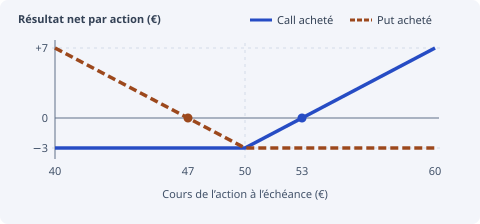

## Combien vaut la liberté de choisir ?

Un marchand de vélos accepte de vous réserver un vélo au prix de 300 €, contre 15 € de réservation non remboursables. Si le même vélo coûte 340 € le jour convenu, votre réservation vous fait économiser 40 € sur l’achat. Après les 15 € versés, votre avantage est de 25 €. Si le prix tombe à 270 €, vous pouvez acheter ailleurs et perdre seulement les 15 €.

> **Analogie** La réservation a deux prix. Les 300 € sont le prix convenu pour le vélo. Les 15 € rémunèrent le marchand pour le droit qu’il vous a accordé. Il doit honorer son engagement si vous choisissez de l’utiliser.

Sur une action, ce droit d’acheter à un prix fixé s’appelle un [call](glossaire:call). Le droit de vendre à un prix fixé s’appelle un [put](glossaire:put). Le prix fixé est le [prix d’exercice](glossaire:prix-exercice), parfois appelé *strike*. La somme payée pour obtenir le droit est la [prime](glossaire:prime). Une option européenne s’exerce à la date prévue, son [échéance](glossaire:echeance). Une option américaine peut aussi s’exercer avant cette date.

## Lire les quatre positions

Prenons une option européenne sur une action, avec un prix d’exercice de **50 €** et une prime de **3 € par action**. Pour comparer les contrats, nous prenons la même prime pour le call et pour le put. Tous les résultats sont donnés par action à l’échéance, hors frais, financement et fiscalité.

| Votre position | Votre droit ou engagement | Résultat si l’action termine à 42 € | Résultat si elle termine à 58 € |
| --- | --- | --- | --- |
| Acheter un call | Vous pouvez acheter à 50 €. | −3 € | +5 € |
| Vendre un call | Vous devez vendre à 50 € si l’acheteur exerce. | +3 € | −5 € |
| Acheter un put | Vous pouvez vendre à 50 €. | +5 € | −3 € |
| Vendre un put | Vous devez acheter à 50 € si l’acheteur exerce. | −5 € | +3 € |

À 58 €, le call donne accès à une action de 58 € pour 50 €. Le droit rapporte **8 € bruts**, puis **5 € nets de la prime**. À 52 €, il est encore avantageux d’exercer pour récupérer 2 €, même si l’opération se termine en perte de 1 € après la prime.

## Tracer le résultat à l’échéance

Pour un call acheté, soustrayez le prix d’exercice au cours final. Gardez zéro si la différence est négative, puis déduisez la prime. La courbe reste horizontale à −3 € jusqu’à 50 €, puis monte de 1 € pour chaque euro de hausse de l’action. Le [seuil de rentabilité](glossaire:seuil-de-rentabilite) est ici **53 €**.

Pour un put acheté, soustrayez le cours final au prix d’exercice, gardez le plus grand résultat entre cette différence et zéro, puis déduisez la prime. À 47 €, vous récupérez exactement les 3 € de prime. Sous ce seuil, le put dégage un bénéfice. Au-dessus de 50 €, la perte reste de 3 €.

À prix d’entrée identique, le résultat du vendeur est l’opposé de celui de l’acheteur. Le vendeur d’un call sans posséder l’action risque une perte théoriquement illimitée si le cours s’envole. Sur une action dont le cours peut tomber à zéro, la perte maximale du vendeur de ce put est de 47 €. Pour chaque acheteur, la perte maximale se limite à la prime.

Sur le dessin, chaque courbe représente **un achat distinct**. Là où elle coupe la ligne de zéro, l’acheteur a exactement récupéré sa prime.

## Pourquoi l’option a-t-elle un prix avant l’échéance ?

Si l’action cote aujourd’hui 52 € avec un prix d’exercice de 50 €, l’écart favorable au call est de 2 €. Cette mesure est sa [valeur intrinsèque](glossaire:valeur-intrinseque). Elle vaut zéro si l’écart est défavorable. Si le call se négocie aujourd’hui 3,50 €, les 1,50 € restants représentent sa [valeur temps](glossaire:valeur-temps). Le marché tient encore compte de ce qui peut se passer avant l’échéance. À l’échéance, la valeur temps disparaît.

> **À retenir** Exercer revient à comparer deux prix aujourd’hui. Calculer le résultat de toute l’opération demande aussi de compter la prime payée ou reçue au départ.

## Dans le manuel

Hull, 10e édition française, §1.5 et §10.1 à 10.4 sur les droits, les positions et les contrats, §11.1 à 11.3 sur les facteurs de prix et les bornes de valeur.
